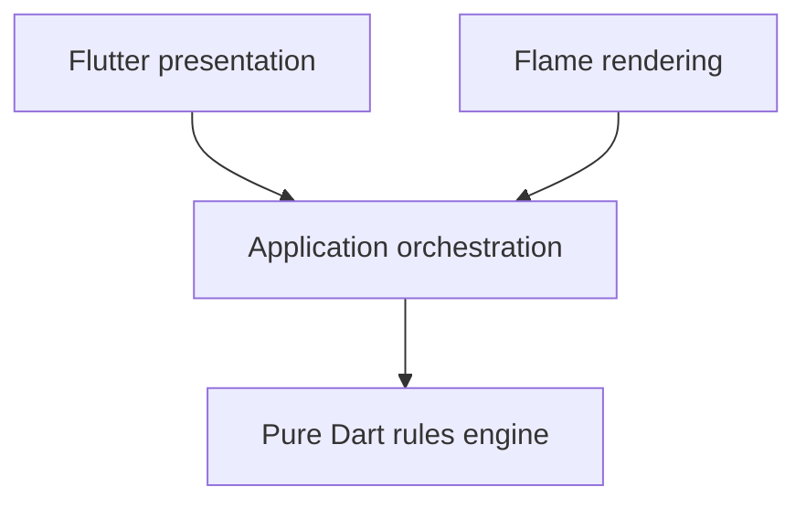

# ADR-001 — Client stack

Status: **Proposed**. Owner approval is required before this status becomes Accepted. This record does not accept the Blueprint and does not add application code.

Jira: [PZD-14](https://puzzle-duel-app.atlassian.net/browse/PZD-14). Evidence: [PZD-14-EVIDENCE.md](../architecture/PZD-14-EVIDENCE.md). Parity: [PZD-14-GAMEPLAY-PARITY.md](../architecture/PZD-14-GAMEPLAY-PARITY.md).

## 1. Context

Puzzle Duel needs one iOS and Android client for a small grid puzzle. The rules are already pinned by `core-001.v1` and the `core-001.v2` terminal-offer extension. Ranked truth stays on the server. The client may animate a result. It may not invent a different result.

The product asks for touch placement, readable movement, a reduced-motion alternative, phone and tablet layout, guest resume, and no mid-puzzle advertising. Those presentation needs are separate from the rules.

## 2. Decision question

Which client technology should own presentation, and where do the gameplay rules live, so that iOS and Android share one deterministic ruleset without treating the client score as ranked truth?

## 3. Evaluated alternatives

| Alternative | Result |
| --- | --- |
| Flutter widgets and Flame rendering, with a pure Dart rules engine | Recommended. |
| Flutter custom rendering without Flame | Rejected as the primary choice. |
| Native Swift and Kotlin only | Rejected for MVP. Recorded as a comparison, not a build request. |
| Flame components as the place that computes score and matches | Rejected. |

## 4. Evidence

Versions, pages, and commands are in [PZD-14-EVIDENCE.md](../architecture/PZD-14-EVIDENCE.md). Short form:

- Current stable Flutter is 3.50.0 with Dart 3.14.0, published 2026-11-11.
- Flutter 3.50 supports Android API 24–37 and iOS 15–27.
- Flame 1.38.2, published 2026-08-27, declares Dart `>=3.11.0 <4.0.0` and Flutter `>=3.41.0`, and depends on Flutter.
- This machine has Flutter 3.47.8 and Dart 3.13.7. A disposable `flutter pub get` resolved Flame 1.38.2 and was deleted. Flame was not executed on Flutter 3.50.0.
- No frame-time number was measured.

Minimum platform assumption, taken from the Flutter 3.50 support page and not from a device run: Android API 24 and iOS 15. Store-policy targets above that floor are an owner choice.

## 5. Constraints

- The rules module must not import Flutter, Flame, `dart:ui`, animation timers, network, authentication, advertising, Firebase, or platform channels.
- `core-001.v1` and `core-001.v2` stay separate. A v1 replay does not gain a null offer slot.
- An empty replacement stream before the move limit, including an early full board, is not a specified v2 tray. The engine must fail closed.
- Local score is not a ranked score. [ADR-002](ADR-002-local-game-state.md) keeps that boundary.
- No production Flutter app is created by this ADR.

Proposed shape:

`rules` has no arrow back to Flame. Flame receives snapshots.

## 6. Advantages and disadvantages

Flame gives a game loop, components, and gesture helpers that a 5×5 to 7×7 animated board would otherwise rebuild. Flutter gives one layout system for phones and tablets, semantics, text scale, and lifecycle signals.

The disadvantage is a rendering library tied to Flutter. Flame 1.38.2 was published before Flutter 3.50 and only declares a minimum of Flutter 3.41.0. That is compatibility by constraint, not a 3.50 execution test. Flame 2 prereleases are not a candidate.

Custom painting without Flame removes that package and leaves gesture arenas, sprite timing, and the game loop to this project. That is a reasonable fallback if Flame's input or lifecycle behavior blocks the puzzle. It is not the starting recommendation.

Two native clients would split the rules. Parity cost is the reason to reject that for MVP.

## 7. Security implications

The rules engine does not hold tokens or ad identifiers. The presentation layer must not send a locally computed score as the official result. Official attempts stay on the server replay described in the backend ranked-replay ADR. Guest data stays inside the bounds of ADR-002.

A compromised animation clock must not change the committed board. State changes only when the application layer submits one move to the rules engine.

## 8. Testing and CI implications

Pure Dart tests can run on Ubuntu and must consume [the fixture suites](../contracts/gameplay/v1/README.md) as specified in the parity document. Flame widget tests are a later presentation suite. They do not replace fixture replay.

This repository's current workflow checks the Python and Node reference checkers when fixture files change. It does not compile Flutter. Adding macOS runners for iOS builds is a later cost and is not part of this change. No dollar figure is claimed.

## 9. Performance considerations

The board is at most 7×7 in the approved MVP profiles. The rules work is small next to rendering. Animation duration must not be the source of cascade order or score. Reduced motion shortens or removes tweens in Flame. The rules result is already complete before those tweens start.

Rapid taps are dropped or queued by the application layer so the engine sees at most one committed move at a time. The exact queue length is an implementation detail for the later UI task, not a rules change.

No frame-time, memory, or battery measurement was run.

## 10. Maintenance and cost implications

One Dart rules module serves both stores. Flutter and Flame upgrades are periodic and must keep the rules package free of those imports. A dependency lint on that package is part of the later scaffold, not this PR.

iOS release CI needs macOS. That is more expensive than Ubuntu and is deferred until a client scaffold exists. Ubuntu remains enough for the pure Dart fixture job.

## 11. Migration and rollback

Nothing in production uses this stack yet. Rollback is to leave this ADR Proposed, or for the owner to reject it and keep the previous one-paragraph candidate. No project file, lockfile, or store binary is migrated.

If Flame is later rejected, the rules package stays. Only the rendering module is replaced.

## 12. Outstanding unknowns

- Flame on Flutter 3.50.0 was not executed.
- Store minimums above API 24 and iOS 15 are not chosen.
- Reduced-motion behavior is a requirement, not a specified animation list.
- Early full-board end with an empty piece stream still has no approved tray.
- Generator retry and corrupt-save recovery remain unspecified. The rules module must reject those states until a later contract defines them.

## 13. Recommendation

Adopt Flutter for presentation, Flame for board rendering and input gestures, and a pure Dart rules engine for `core-001.v1` and `core-001.v2`. Target Flutter 3.50.0 and Dart 3.14.0 when the application is scaffolded. Flame 1.38.2 is the current stable package and resolves on Flutter 3.47.8; re-resolve it on 3.50.0 at scaffold time. Do not start from Flame 2 prereleases.

Reject a native-only client for MVP. Keep custom rendering without Flame as a documented fallback, not the selection.

## 14. Owner-approval requirements

The owner decides whether this Proposed record becomes Accepted. Acceptance is required before `flutter create`, Flame dependency commits, or UI implementation. This PR does not perform that acceptance.

PZD-12 does not block this client recommendation. It blocks backend host claims only.
