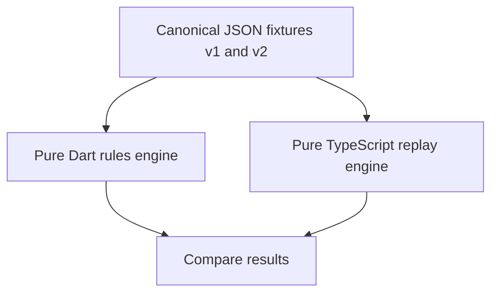

# PZD-14 gameplay parity

Status: proposed verification design. This file does not accept an ADR and does not add an engine.

Client and backend must produce the same canonical outcomes for the same ruleset. They do that with two implementations. The Dart engine is not copied into the backend, and Flutter does not run inside NestJS.

## What already exists

`docs/contracts/gameplay/v1/` and `docs/contracts/gameplay/v2/` contain language-neutral fixtures, JSON Schema, a Python checker, and a Node checker. Those checkers are the current contract reference. A green Python or Node run is not Dart engine parity and not TypeScript product-engine parity. Product engines are **NOT_RUN** until those engines exist and are executed.

Historical `core-001.v1` fixtures `01`–`12` stay byte-for-byte. `core-001.v2` is the nullable spent-slot extension for the move that reaches `moveLimit` with an empty `futurePieces` list. An empty stream when the board fills before the move limit has no approved tray. Engines must not invent one.

## Module boundary

The rules engine on each side is a pure module:

- It reads a ruleset id, a state value, and a move value.
- It returns a result value or a named rejection.
- It does not import Flutter, Flame, widgets, animation clocks, HTTP, authentication, advertising, Firebase, or platform APIs.
- NestJS decorators and database clients stay outside the TypeScript rules module. The Nest application calls the module. The module does not call Nest.
- Rendering reads an immutable snapshot. It does not compute score, matches, or the next offer.

Public surface, named here and not implemented:

| Piece | Responsibility |
| --- | --- |
| `rulesVersion` | Selects `core-001.v1` or `core-001.v2`. Any other id is rejected. |
| State | Board, blocked cells, offers, future pieces, turns, score, status. |
| Move | Offer index and tap. Illegal moves do not change state. |
| Resolution | Placement, match, clear, shift, cascade, score, then end. |
| v1 empty stream | Abort. Do not invent a piece and do not write null. |
| v2 terminal slot | Null only the consumed slot when the move reaches `moveLimit` and the stream is empty. Offers stay length 3. At most one null, and never while `in_progress`. |
| Replay | The same state and moves produce the same result. Order is the fixture order. |

Version dispatch is a table from ruleset id to a function. `v1` does not call `v2`. A saved attempt keeps the id it started with.

## How a future engine consumes fixtures

1. Discover suite directories `docs/contracts/gameplay/v1` and `docs/contracts/gameplay/v2`. Do not hard-code a single ruleset.
2. Validate each document with that suite's `fixture.schema.json` plus the cross-field checks the schema text already assigns to the checker.
3. Replay every golden scenario. Compare landing, waves, score, offers, future pieces, turns, and status with the expected JSON.
4. Replay negative fixtures. The rejection code must match. State must be unchanged.
5. Replay each golden scenario twice and compare the two results.
6. Fail the job on any mismatch, skipped fixture, unknown ruleset, or checker abort that the fixture did not expect.

The Dart job and the TypeScript job both read the fixture files. They do not read each other's outputs as the oracle. The fixture JSON is the oracle. A later comparison job may also diff the two engines' normalized results against each other; a difference fails even if both somehow matched a stale expected file.

## CI failure conditions

- A golden step differs from its expected JSON.
- A negative case is accepted, or is rejected with a different code.
- A second replay differs from the first.
- `core-001.v1` writes a null offer or continues after an empty stream.
- `core-001.v2` writes null because the board filled before `moveLimit`.
- The gameplay contract tree differs between the client and backend repositories.

Cross-repository parity of the contract files is a hash or Git tree comparison of `docs/contracts/gameplay`. It is separate from engine execution.

## Current CI

`.github/workflows/pzd11-fixtures.yml` runs the Python checker, the Node checker, and checksums when fixture paths change. It does not run a Dart engine or a NestJS engine. Documentation-only pulls do not add those jobs. Until the engines exist, engine rows stay **NOT_RUN**.
