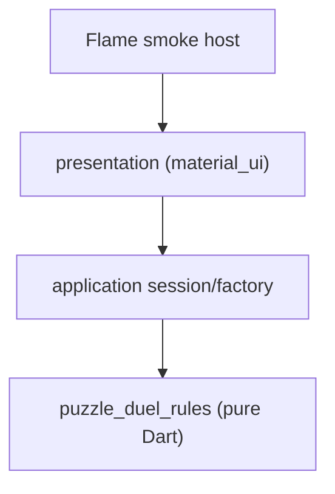

# PZD-22 — Flutter application bootstrap

Jira: [PZD-22](https://puzzle-duel-app.atlassian.net/browse/PZD-22)  
Parent: PZD-3 — Mobile Game Experience  
Branch: `feature/PZD-22-flutter-app-bootstrap`

## 1. Implementation scope

Delivers a production-oriented Flutter iOS/Android shell that:

- Uses Accepted ADR-001 stack pins (Flutter 3.50.0 / Dart 3.14.0 / Flame 1.38.2 / `material_ui`)
- Integrates existing `packages/puzzle_duel_rules` by path dependency
- Exposes a guest-first offline startup screen with a development-only generator smoke test
- Does **not** implement the playable board (PZD-23) or durable local persistence (PZD-24)

## 2. Architecture and dependency direction



Rules never depend on Flutter, Flame, `dart:ui`, network, auth, ads, or Firebase. Flame receives presentation-only probes; it does not own canonical rules state.

## 3. Accepted ADR references

| ADR | Status used | Effect on PZD-22 |
| --- | --- | --- |
| ADR-001 Client stack | **Accepted** | Stack pins, `material_ui`, Flame gate prerequisite |
| ADR-002 Local game state | **Proposed** | No durable guest persistence implemented here |
| ADR-003 Ads and privacy | Proposed / out of scope | No ad or analytics SDK initialized |

## 4. Exact versions

| Component | Version |
| --- | --- |
| Flutter SDK | 3.50.0 (`ab2912035e`) |
| Dart SDK | 3.14.0 |
| Flame | 1.38.2 |
| material_ui | 1.11.0 |
| puzzle_duel_rules | 0.1.0 (path) |
| iOS deployment target | 15.0 |
| Android minSdk | 24 (explicit) |
| Android compileSdk / targetSdk | 36 (Flutter 3.50.0 toolchain default) |

## 5. Compatibility spike evidence (Phase A)

Executed **outside** the repository in `/tmp/pzd22-compat-spike` before `flutter create`.

| Check | Result | Evidence |
| --- | --- | --- |
| SDK | **PASS** | Flutter 3.50.0 / Dart 3.14.0 |
| Resolve Flame 1.38.2 | **PASS** | `flutter pub get`; lock `flame 1.38.2` |
| Analyze GameWidget + ColorEffect + material_ui | **PASS** | `No issues found!` |
| Public API compatibility | **PASS** | Compile-time references + smoke test mount |
| Legacy Material in Flame | Documented | Flame still imports `package:flutter/material.dart`; app-owned code does not. `MaterialUiCompatibilityBridge` used for theme/localizations only |

Commands:

```bash
export PATH="/tmp/pzd17-flutter/flutter/bin:$PATH"
flutter --version
# disposable project with flame:1.38.2 + material_ui
flutter pub get
flutter analyze
flutter test
```

Summaries copied under `docs/mobile/evidence/`.

## 6–8. Platform targets and layout

```text
apps/mobile/                 # puzzle_duel_mobile
  lib/main.dart
  lib/app/puzzle_duel_app.dart
  lib/application/
  lib/presentation/
  lib/theme/
  test/
  ios/                       # IPHONEOS_DEPLOYMENT_TARGET = 15.0
  android/                   # minSdk = 24
packages/puzzle_duel_rules/  # unchanged engine APIs
```

## 9. Running locally (new macOS machine)

1. Install Flutter **3.50.0** stable (do not use an older SDK for this app).
2. `flutter doctor` until iOS and/or Android toolchains are usable.
3. From repo root:

```bash
cd packages/puzzle_duel_rules && dart pub get && dart test
cd ../../apps/mobile
flutter pub get
flutter analyze
flutter test
flutter run
```

## 10. Device / simulator commands

```bash
# iOS (executed): iPhone 16 Pro / iOS 18.3 simulator
xcrun simctl boot <UDID>
flutter run -d <UDID>

# Android (executed): Medium Phone API 37 emulator
flutter emulators --launch Medium_Phone_API_37.0
flutter run -d emulator-5554
```

## 11. Automated test commands

```bash
cd packages/puzzle_duel_rules && dart test          # 96 PASS
cd apps/mobile && flutter analyze                  # No issues found
cd apps/mobile && flutter test                     # 16 PASS
python3 tools/pr_quality_gate_test.py
python3 tools/pr_quality_gate.py --event pull_request
```

## 12. CI workflow references

| Workflow | Role |
| --- | --- |
| `.github/workflows/dart-rules.yml` | Pure Dart engine tests (preserved) |
| `.github/workflows/pzd11-fixtures.yml` | Fixture / checksum gates (preserved) |
| `.github/workflows/pr-quality-gate.yml` | PR template / secret / ADR gates (preserved) |
| `.github/workflows/flutter-mobile.yml` | **New** Linux Flutter 3.50.0 `pub get` / `analyze` / `test` |

Linux Flutter CI ≠ iOS compile ≠ simulator launch. Those are separate results.

## 13. Offline foundation evidence

- `main.dart` initializes only an in-memory `ChallengeSession`
- No backend URL, HTTP client, auth, ads, or analytics packages
- Generator smoke test uses local `generateChallenge`
- Widget tests assert startup without sign-in and exercise generation offline
- Architecture guard fails if rules import Flutter/Flame/`dart:ui`

Airplane-mode interactive proof on device was not separately scripted; automated offline bootstrap coverage is PASS. Full offline free-play/resume is PZD-24.

## 14. Deferred work and unresolved decisions

- PZD-23: Flame board rendering, gestures, animations, reduced motion
- PZD-24: durable guest persistence / resume (ADR-002 still Proposed)
- Store minimums above API 24 / iOS 15
- Flame upstream migration off deprecated Material imports
- Backend twin update for any shared PZD-14 evidence bytes if gate log is mirrored

## 15. Rollback

1. Close/revert the PZD-22 PR without merge.
2. Delete `apps/mobile/` and `.github/workflows/flutter-mobile.yml` if needed.
3. `packages/puzzle_duel_rules` remains valid independently.

## 16. Security / privacy

- No secrets, signing certificates, provisioning profiles, or `.env` committed
- `android/local.properties` remains gitignored (machine SDK path)
- Local generator score is labeled non-ranked
- No personal data collected at bootstrap

## 17. PASS / FAIL / NOT_RUN matrix

| Gate | Result |
| --- | --- |
| Flutter 3.50 compatibility gate | **PASS** |
| Flame 1.38.2 resolution + analyze + smoke | **PASS** |
| Legacy public-type boundary for required APIs | **PASS** |
| iOS/Android targets generated | **PASS** |
| Platform minimums recorded | **PASS** |
| Rules path dependency; engine stays pure | **PASS** |
| Minimal startup UI | **PASS** |
| Offline bootstrap (automated) | **PASS** |
| Application unit/widget tests | **PASS** (16) |
| Flutter analyze | **PASS** |
| Dart engine regressions | **PASS** (96) |
| iOS simulator launch | **PASS** (iPhone 16 Pro, iOS 18.3) |
| Android emulator launch | **PASS** (API 37 emulator-5554) |
| CI on final HEAD | Record after PR checks complete |
| Merge / deploy / Jira Done | **NOT authorized** |

## Dependency inventory (direct)

| Package | Version | License | Purpose |
| --- | --- | --- | --- |
| flutter | SDK | BSD-style | Application framework |
| material_ui | 1.11.0 | BSD-style (Flutter Authors) | First-party design library |
| flame | 1.38.2 | MIT | Rendering smoke / future board host |
| puzzle_duel_rules | 0.1.0 path | Repo | Canonical rules + generator |
| ordered_set (transitive via Flame) | 8.0.1 | MIT | Flame component ordering |
