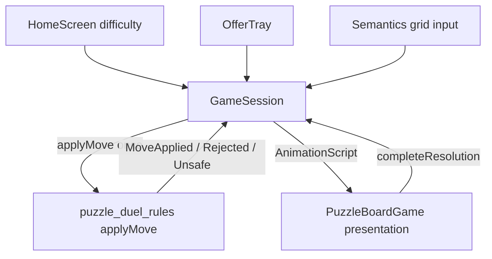

# PZD-23 — Accessible playable board

Jira: [PZD-23](https://puzzle-duel-app.atlassian.net/browse/PZD-23)  
Branch: `feature/PZD-23-accessible-game-board`  
Baseline: PZD-22 `71b1c07`

## Architecture and gameplay interaction



- Canonical state lives only in `GameSession` after each engine result.
- Flame projects `AnimationScript` events; it never scores, matches, or generates pieces.
- Flutter semantics overlay is the accessible input path; Flame is visual-only (`IgnorePointer`).

## Engine ownership boundaries

| Concern | Owner |
| --- | --- |
| Generation, placement, clear, shift, score, offers, end | `puzzle_duel_rules` |
| Selected offer index, rapid-tap gate, generation id | `GameSession` |
| Temporary board projection during animation | `PresentationBoard` + `PuzzleBoardGame` |
| Durable save/resume | **Deferred to PZD-24** |

## Input transaction lifecycle

1. `selectOffer(index)` while `playing`.
2. `submitTap(coord)` builds `Move` and calls `applyMove` **once**.
3. `MoveApplied` → set `canonicalState = finalState`, mint a new `resolutionId`, publish `AnimationScript`, phase `resolving`.
4. `MoveRejected` / `MoveUnsafe` → keep prior state, show feedback.
5. Animation completion / skip / reduced-motion → `completeResolution(generation, resolutionId)`.
6. Stale callbacks must match **both** round `generation` and per-move `resolutionId`; otherwise they are ignored.
7. Restart / menu / new move invalidates prior resolution tokens.

Shift presentation interpolates piece centers between `from` and `to` (presentation-only). Gameplay remains engine-owned; no physics.

UAT seed: `kUatChallengeSeed = 42` (internal/debug only — **not** shown on the primary player-facing UI).

## Visual overhaul (pre–visual UAT)

See `docs/mobile/PZD-23-VISUAL-OVERHAUL.md` and evidence under `docs/mobile/uat-evidence/pzd23-visual/`.

Presentation uses `GameTokens` + `PuzzleDuelTheme.dark()`, difficulty cards on home, board-first HUD, premium `PiecePainter` glyphs, and end-of-round overlay. Gameplay/engine contracts are unchanged.

## Visual animation state model

Steps from `buildAnimationSteps`:

1. Place at canonical `landing`
2. Per wave: clear flash → remove cleared → simultaneous `MovedPiece` shifts
3. Settle → display equals `finalState`

Reduced motion (`MediaQuery.disableAnimations` or platform reduce-motion) jumps to `finalState` then completes.

## Accessibility

- Cell labels: `Row R, column C, empty|blocked|<shape> pointing <direction>`
- Offer slots announce selection and emptiness
- Score / moves / end status use live regions
- Shape + chevron arrow glyphs remain distinguishable without hue alone
- Large text exercised on home; board uses scalable layout

## Test results (local)

```bash
cd packages/puzzle_duel_rules && dart test
# +96: All tests passed!

cd apps/mobile && flutter analyze
# No issues found!

cd apps/mobile && flutter test
# +25: All tests passed!
```

## Device smoke

| Target | Result |
| --- | --- |
| iPhone 16 Pro simulator (iOS 18.3) `604433CB-5A0E-415D-A7A3-26BA0B433ADF` | **PASS** — `flutter run` reached interactive session |
| Android emulator `emulator-5554` (API 37) | **PASS** — debug APK installed and interactive |

Physical-device UAT: **NOT_RUN**.

## Performance

**NOT_RUN** — no physical-device frame timing captured. Emulator/simulator launch is not a 60 fps PASS claim.

## Deferred

- PZD-24 persistence / resume / personal best
- Production seed / daily rotation policy
- Ranked submission

## UAT checklist and commands

See final report §13. Quick start:

```bash
export PATH="/path/to/flutter-3.50.0/bin:$PATH"
cd apps/mobile
flutter run -d <ios-simulator-id>
flutter run -d <android-emulator-id>
```

Play Easy/Medium/Hard with seed 42. No login or network required.
